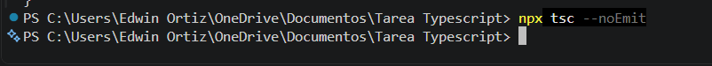
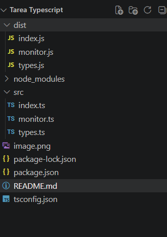
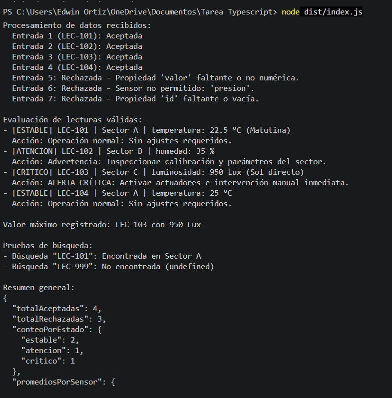

# Monitor de Condiciones - Invernadero Urbano

Proyecto en TypeScript para Node.js que simula el monitoreo de un invernadero urbano. La idea es recibir datos de sensores (temperatura, humedad y luz), validar que los datos que entran sean correctos, clasificar el estado de las zonas y sacar un resumen con promedios sin modificar los datos originales.

---

## Requisitos e Instalación

### Requisitos
* Node.js v18 o superior
* npm

### Pasos
1. Entrar a la carpeta del proyecto:
   ```bash
   cd invernadero-monitor
   ```
2. Instalar las dependencias (TypeScript está instalado de forma local):
   ```bash
   npm install
   ```
3. Verificar la versión local de TypeScript:
   ```bash
   npx tsc --version
   ```

---

## Estructura del Proyecto

```text
Tarea Typescript/
├── README.md
├── package.json
├── tsconfig.json
└── src/
    ├── index.ts      # Corre las pruebas con el lote de datos
    ├── types.ts      # Tipos, interfaces y tuplas
    └── monitor.ts    # Funciones para validar, clasificar y resumir
```

---

## Comandos para Probar y Ejecutar

* **Chequear tipos sin compilar:**
  ```bash
  npm run typecheck
  ```
* **Compilar a JavaScript (genera la carpeta `dist/`):**
  ```bash
  npm run build
  ```
* **Ejecutar el programa ya compilado:**
  ```bash
  npm start
  ```

---

## Decisiones Técnicas

### ¿Por qué emito archivos JS a `dist/` en lugar de usar `noEmit: true`?
En frameworks como React o Vite, los empaquetadores procesan el código en memoria, por lo que TypeScript solo se usa para validar tipos (`noEmit: true`). En este caso, como la app se corre directamente con Node.js y Node no entiende archivos `.ts` nativamente, necesito que `tsc` compile el código de `src/` a JavaScript ejecutable dentro de `dist/`.

### Uso de `unknown` en vez de `any`
Uso `unknown` para tipar la entrada externa porque no sé si los datos vienen completos o con errores. Si usara `any`, TypeScript no me avisaría si intento acceder a una propiedad que no existe o si llamo a un método incorrecto (por ejemplo `valor.toFixed()` cuando `valor` vino como un texto `"25"`), lo que rompería la app en ejecución. Con `unknown`, TypeScript me obliga a validar primero tipo por tipo antes de usarlos.

### Validación en TypeScript vs Runtime
TypeScript solo valida los tipos mientras estoy programando y compilando. Una vez que el código se compila a JavaScript, los tipos e interfaces desaparecen. Por eso creé la función `validarLectura()` en runtime: para revisar con `typeof` e `includes()` si el objeto real que entra tiene las propiedades necesarias y descartar los datos malos antes de meterlos al sistema.

### Elección de `type` e `interface`
* **`interface Lectura`**: Lo usé para el modelo principal de la lectura porque es un objeto claro y fácil de leer.
* **`type`**: Lo usé para las uniones de texto (`TipoSensor`, `EstadoLectura`), para la tupla de rangos `[min, max]` y para la unión de resultados `ResultadoValidacion`.

### Manejo de arreglos e inmutabilidad
* Para ordenar las lecturas por valor y sacar la más alta, usé `[...clasificadas].sort()` para crear una copia antes de ordenar y no alterar el arreglo original.
* Como en `tsconfig.json` tengo activado `noUncheckedIndexedAccess`, al hacer `copiaOrdenada[0]` TypeScript me avisa que el resultado puede ser `undefined`. Por eso le puse un `if (mayor !== undefined)` para evitar leer propiedades de un valor inexistente.
* Con `exactOptionalPropertyTypes`, la propiedad `nota` solo se agrega si realmente viene un string, evitando pasarle `undefined` explícito.
* Para el manejo exhaustivo con `never`, usé la función `assertExhaustive()` en el `default` del `switch` de estados. Así, si en el futuro agrego un estado nuevo y olvido ponerlo en el `switch`, TypeScript me da un error de compilación.

---

## Tabla de Casos de Validación

| Caso / Entrada | Qué se probó | Resultado Esperado | Resultado en Consola |
| :--- | :--- | :--- | :--- |
| `LEC-101` | Objeto completo con nota y valores correctos. | Aceptado (`estable`) | Aceptado |
| `LEC-102` | Sin nota opcional y con valor bajo el rango. | Aceptado (`atencion`) | Aceptado |
| `LEC-103` | Valor muy alto fuera de rango. | Aceptado (`critico`) | Aceptado |
| `LEC-ERR-01` | La propiedad `valor` vino como string (`"25.0"`). | Rechazado | Rechazado: Propiedad 'valor' faltante o no numérica |
| `LEC-ERR-02` | El tipo de sensor no existe (`"presion"`). | Rechazado | Rechazado: Sensor no permitido |
| Objeto sin ID | Falta la propiedad `id`. | Rechazado | Rechazado: Propiedad 'id' faltante o vacía |
| Búsqueda `LEC-999` | Buscar un ID que no está en la lista. | Retornar `undefined` de forma segura | Manejado correctamente (`undefined`) |

---

### 7. Evidencias

* Comprobación de Tipos sin Emisión (`npx tsc --noEmit`)


* Compilación a JavaScript (`npx tsc`)


* Ejecución de Aplicación (`node dist/index.js`)

